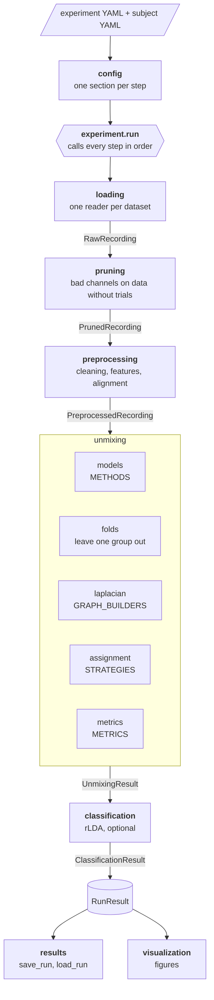

# fNIRS_EEG_pipeline

Recover the sources that simultaneous EEG and fNIRS recordings share, and classify
motor tasks from them.

The pipeline fits CCA-family models (CCA, tCCA, mSPoC and their sparse, ridge, elastic
net and structured sparse variants) to simultaneous EEG and fNIRS recordings of a motor
task. Each model returns pairs of components, one EEG and one fNIRS component found
together. The pipeline assigns a pair to each hand and then classifies the trials
(left, right, rest) from the components with rLDA.

It runs on two kinds of data:

- **Synthetic data**, where the true sources and mixing matrices are known, so the
  recovered components can be scored against the ground truth.
- **Real data** from the hybrid EEG-fNIRS datasets of Buccino et al. (2016) and
  Shin et al. (2017, dataset A), where there is no ground truth and the pairs are
  assigned from the motor channels or the task timing instead.

This code was written for the master's thesis *From Unsupervised fNIRS–EEG Fusion to
Supervised Neural Decoding: Investigating Source Decomposition Methods and
Classification Strategies on Synthetic and Real Data* at the
[Intelligent Biomedical Sensing (IBS) Lab](https://ibs-lab.com/) and
[BIFOLD](https://bifold.berlin/), Technische Universität Berlin.

The pipeline is modular: every step is its own package with a small public API, and
the datasets, methods, pair assignments and selection metrics are registries you can
add to. The datasets above are the ones it ships with, not a fixed format; see
[Adapting the pipeline](#adapting-the-pipeline) to run it on your own data.

## How it works

One run takes one experiment config and one subject config. `src/experiment.py` is
the only place that knows the order of the steps: it calls each step with its own
config section and hands the step's output to the next. No step calls another, so
any step can be changed or replaced without touching the others.



Each box is a package in `src/`; the labels on the arrows are the dataclasses
(`src/types.py`) one step returns and the next takes.

1. **Loading** (`src/loading`) reads the subject's EEG and fNIRS recordings and
   applies the montage from the subject config, so the electrode and optode
   positions travel with the data from then on.
2. **Pruning** (`src/pruning`) finds bad EEG and fNIRS channels on data without
   trials: the EEG of each recording on its own, the fNIRS on a rest period the
   dataset's reader selects. Bad EEG channels are interpolated in the runs of the
   recording they are bad in; a fNIRS channel bad anywhere is dropped from every run.
3. **Preprocessing** (`src/preprocessing`) cleans the EEG (including ICA) and turns
   it into band power or a band-passed signal, band-passes the HbO, cuts both to the
   stimulus window on one time axis and z-scores them. Synthetic ground truth goes
   through the same transforms.
4. **Unmixing** (`src/unmixing`) selects each method's hyperparameters by
   leave-one-group-out cross-validation, fits the selected model and scores it on
   a held-out test group. Nested evaluation is optional.
5. **Classification** (`src/classification`) classifies the trials of each held-out
   group with rLDA on the recovered components.
6. **Results** (`src/results`, `src/visualization`) saves everything as data and
   draws the figures from what was saved.

The modules are layered: a module imports only from modules below it, and the shared
dataclasses live in `src/config` and `src/types.py`.

### Methods

All models come from [cedalion](https://github.com/ibs-lab/cedalion)
(`cedalion.sigdecomp.multimodal`).

| Name | Model |
|---|---|
| `CCA` | Canonical correlation analysis |
| `SparseCCA`, `RidgeCCA`, `ElasticNetCCA` | CCA with L1, L2 or both penalties |
| `StructuredSparseCCA` | Elastic net CCA with a graph Laplacian over the channels |
| `tCCA` | Temporally embedded CCA, finds a time shift per component |
| `ElasticNetTCCA`, `StructuredSparseTCCA` | The penalised variants of tCCA |
| `mSPoC` | Multimodal source power co-modulation, on the band-passed EEG |

### Assigning pairs to hands

A model does not know which pair belongs to which hand. The experiment config chooses
how the pairs are assigned (`unmixing.assignment.method`):

- `ground_truth` matches the pairs to the simulated sources (synthetic data only).
- `motor_channels` gives each hand the pair whose mixing lies most on that hand's
  motor channels (for example C3 for the right hand, C4 for the left).
- `task_regressors` gives each hand the pair whose components follow that hand's
  trials best.

A pair is never split: a hand always gets the EEG and the fNIRS component of one pair.

## Adapting the pipeline

Every part of the pipeline can be changed. Most changes are a config value; the
others are one new function or class, registered in one place, after which the
config can name it.

| To | Add or change | Where |
|---|---|---|
| Run on your own dataset | A reader module with `REQUIRED_PATHS`, `check`, `read_recordings`, `read_background` and `select_pruning_recordings`, returning `RawRecording` objects. Register it in `READERS` and set `format:` in your subject configs to its name. | `src/loading/load.py` |
| Add a decomposition method | An entry in `METHODS`: the model class, its hyperparameters, the EEG feature it needs and whether it is temporal or structured. Any class with the `fit` / `transform` interface of the cedalion models works. Give it a grid in `configs/unmixing/grids.yaml`. | `src/unmixing/models.py` |
| Assign pairs to the classes differently | A function with the signature of `ground_truth`, registered in `STRATEGIES`. | `src/unmixing/assignment.py` |
| Select hyperparameters by another criterion | A `Metric` in `METRICS`. | `src/unmixing/metrics.py` |
| Use another channel graph for the structured methods | A builder in `GRAPH_BUILDERS`. | `src/unmixing/laplacian.py` |
| Change pruning or preprocessing | The values in `configs/pruning/` and `configs/preprocessing/`, or the code in the step's package. | `src/pruning`, `src/preprocessing` |
| Change the electrode or optode positions | The `montage` section of the subject config: an MNE template, a position file or a layout. | `configs/subjects/` |
| Add or reorder steps | The list of calls in `run`. | `src/experiment.py` |

A reader is the only part that knows a dataset's file layout. Everything after
loading works on `RawRecording` objects, so once a reader exists, the rest of the
pipeline runs on the new data unchanged.
[Notebook 06](notebooks/06_your_own_data.ipynb) adds a reader, a metric, a method and
an assignment strategy step by step.

## Installation

The pipeline needs cedalion at the commit it was developed against (`730c3e2` on
cedalion's `dev` branch) and conda.

```bash
# cedalion, following its own installation guide
git clone https://github.com/ibs-lab/cedalion.git
cd cedalion
git checkout 730c3e2
conda env create -n cedalion -f environment_dev.yml
conda activate cedalion
pip install -e . --no-deps

# the two packages this pipeline needs on top of cedalion's environment
pip install pyprep python-picard

# this repository
cd ..
git clone https://github.com/valvido/fNIRS_EEG_pipeline.git
cd fNIRS_EEG_pipeline
```

To check the installation, run the tests. They need no data:

```bash
pytest
```

## Data

No data is included in this repository. Put it under `data/` (ignored by git); the
subject configs in `configs/subjects/` say where each file is expected.

### Synthetic data

The synthetic recordings are generated with synthetic_DOT-EEG_pipeline, which is not
public. Any data in the layout below can be used instead; the reader expects one
folder per dataset:

```
data/synthetic/<dataset>/simulation_config.yaml
    the simulation's settings; source_config.trial_source_map names each source's hand
data/synthetic/<dataset>/[<subject_id>/]<subject_id>_<group>/run_<nnn>_seed_<seed>/
    *_raw.fif                  EEG
    *_amp_*.snirf              fNIRS amplitude, stim table, optode geometry
    *_s_eeg_temporal_*.nc      ground truth: EEG source time courses
    *_s_fnirs_temporal_*.nc    ground truth: fNIRS source time courses
    *_A_eeg_*.nc               ground truth: EEG mixing matrix
    *_A_fnirs_*.nc             ground truth: fNIRS mixing matrix
```

Channels are pruned on the background recordings the simulation was built on, one
per group: the EEG of each group on its own background, the fNIRS on the first minute
of the earliest one. These are real recordings from an experiment of the IBS Lab and
are not public either. The reader expects them in the folder `paths.background` of the
subject config, named after the group:

```
data/background_recordings/<subject_id>/<subject_id>_<group>-raw.fif
data/background_recordings/<subject_id>/<subject_id>_<group>.snirf
```

`configs/subjects/synthetic/sub01/sub01_snr_fnirs-5_eeg5.yaml` is an example subject
config for this layout; copy it for each subject and SNR you simulate.

### Real data (Buccino et al., 2016)

The hybrid EEG-fNIRS SMR BCI dataset: 15 subjects, motor execution of the right and
left hand and arm, one MATLAB file per subject. Download it as described in the
paper's data availability statement and place the files where
`configs/subjects/buccino/<subject>/<subject>.yaml` points, for example:

```
data/real_buccino/EEG-fNIRS hybrid SMR BCI data S1-S8/S1.mat
```

The dataset has no optode positions; `configs/montages/buccino_fnirs.tsv` gives the
optode sites of each channel, reconstructed from Fig. 1 of the paper.

### Real data (Shin et al., 2017, dataset A)

The open access EEG+NIRS dataset: 29 subjects, left versus right hand motor imagery in
sessions 1, 3 and 5. Each subject has an EEG and a NIRS folder of BBCI toolbox files
(`cnt.mat`, `mrk.mat`, and `mnt.mat` for the NIRS). Download the MATLAB version and
place the folders where `configs/subjects/shin2017/<subject>/<subject>.yaml` points,
for example:

```
data/real_shin_luhmann/EEG_01-05/subject 01/with occular artifact/
data/real_shin_luhmann/NIRS_01-29/subject 01/
```

Each motor imagery session is split into two blocks of 10 trials, which are the
cross-validation groups (`session<k>_block<b>`). `configs/montages/shin2017_fnirs.tsv`
gives the optode sites of each channel, from the dataset's `mnt.mat`, and
`configs/pruning/shin2017.yaml` the pruning settings: a 50 Hz notch only, since the EEG
is at 200 Hz, and FCC3h, CCP3h, FCC4h, CCP4h as motor electrodes, since the montage has
no C3 or C4.

## Usage

A run takes an experiment config (what to run) and a subject config (which data):

```bash
python main.py --config configs/experiments/default.yaml \
               --subject configs/subjects/synthetic/sub01/sub01_snr_fnirs-5_eeg5.yaml
```

To run one experiment on every SNR dataset of the synthetic subjects:

```bash
python scripts/run_snr_sweep.py --config configs/experiments/default.yaml
```

Every run writes to `results/runs/<experiment>/<dataset>/<started>/`: the data to
`results/` and the figures to `figures/`. A run can be read back and redrawn without
running the pipeline again:

```python
from src.results import load_run
from src.visualization import save_figures

result = load_run(run_dir)
save_figures(result, run_dir / "figures")
```

### Configuration

| File | What it says |
|---|---|
| `configs/experiments/*.yaml` | What to run: methods, metrics, assignment, classification |
| `configs/subjects/<format>/<subject_id>/*.yaml` | Which data: paths, montage, groups, test group |
| `configs/pruning/*.yaml` | Bad-channel detection |
| `configs/preprocessing/*.yaml` | Signal preprocessing (CCA family or mSPoC) |
| `configs/unmixing/grids.yaml` | Hyperparameter grids of every method |

Every setting is explained in [docs/config_reference.md](docs/config_reference.md).

## Tutorials

The notebooks in `notebooks/` walk through the pipeline step by step, with the same
functions `main.py` runs, and are saved with their outputs so they can be read on
GitHub without running anything. They use the example synthetic subject and the
`tutorial` experiment by default. To run them on your own data, point the subject
config at the top of each notebook at yours; if your files are in a format the
pipeline does not read yet, add a loader for it first, as notebook 06 shows.

| Notebook | What it covers |
|---|---|
| [01 Configs and loading](notebooks/01_configs_and_loading.ipynb) | The subject and experiment configs, the recordings, sensor positions, trials and ground truth |
| [02 Pruning](notebooks/02_pruning.ipynb) | Finding bad EEG and fNIRS channels on data without trials, and why each one was flagged |
| [03 Preprocessing](notebooks/03_preprocessing.ipynb) | From raw EEG and fNIRS to the band power and HbO the models are fit on |
| [04 Unmixing](notebooks/04_unmixing.ipynb) | Fitting a CCA model, assigning its pairs to the hands, choosing hyperparameters, a full run |
| [05 Results and classification](notebooks/05_results_and_classification.ipynb) | Reading a saved run back, its scores, figures and classification |
| [06 Your own data](notebooks/06_your_own_data.ipynb) | Adding a dataset reader, a selection metric, a method and an assignment strategy |

## Repository layout

```
main.py                 entry point: one experiment on one subject
configs/                experiment, subject, pruning, preprocessing and grid configs
src/                    the pipeline, one package per step
scripts/                batch runs (SNR sweep)
notebooks/              tutorials, one per pipeline step
tests/                  pytest suite with its own fixture configs
docs/                   config reference, metrics, Laplacians, references
```

## Documentation

- [Config reference](docs/config_reference.md)
- [Metrics](docs/metrics.md)
- [Graph Laplacians](docs/laplacians.md)
- [References](docs/refrences.md)

## Citation

If you use this code, please cite the thesis:

```bibtex
@mastersthesis{vidovic2026,
  author = {Valentina Vidovic},
  title  = {From Unsupervised {fNIRS}--{EEG} Fusion to Supervised Neural Decoding:
            Investigating Source Decomposition Methods and Classification
            Strategies on Synthetic and Real Data},
  school = {Technische Universit{\"a}t Berlin},
  year   = {2026}
}
```

## License

MIT, see [LICENSE](LICENSE).
